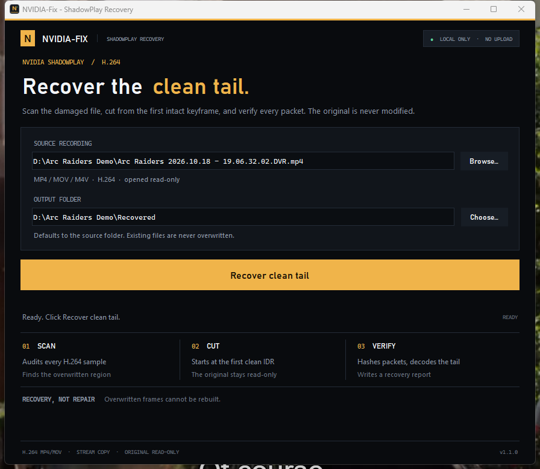

# NVIDIA-Fix

**Recover the clean tail of a corrupted NVIDIA ShadowPlay recording — locally, without re-encoding the surviving video.**

[](https://github.com/yassine808/NVIDIA-fix/actions/workflows/ci.yml)
[](https://github.com/yassine808/NVIDIA-fix/releases/latest)
[](https://github.com/yassine808/NVIDIA-fix/releases)
[](LICENSE)
[](#desktop-app-windows)

<p align="center">
  <a href="https://github.com/yassine808/NVIDIA-fix/releases/latest/download/NVIDIA-Fix.exe">
    
  </a>
</p>

NVIDIA-Fix is a native Windows desktop app and command-line tool for a specific
ShadowPlay failure: the recorder replaces the beginning of a clip with a
byte-shifted copy of later footage while leaving the MP4 index intact. Players
show a broken or duplicated opening, but the ending is usually untouched.

NVIDIA-Fix finds the exact point where the damage stops, stream-copies the
clean tail from the first verified keyframe, exports the surviving early audio,
and writes a JSON report with the evidence.

It is deliberately honest: **it recovers what still exists, and it tells you
what was destroyed.**

## Screenshots




## Why the first part cannot be rebuilt

This is not a missing index, a bad moov atom, or a file-header problem. In the
real recording used to validate this tool, the first **113.78 seconds** of video
were overwritten in place with a drifting copy of later video, followed by
high-entropy garbage. The original bytes no longer exist in the file.

Forensic packet mapping from that recording:

| Original timestamp | Bytes now come from |
| --- | --- |
| `0.00 s` | `182.315 s` |
| `10.01 s` | `193.531 s` |
| `30.01 s` | `213.506 s` |
| `50.01 s` | `234.764 s` |
| `70.01 s` | `259.622 s` |
| `90.01 s` | `281.880 s` |
| `100.01 s` | `291.913 s` |
| `110.01 s` | no match — garbage |

The container still describes a 300-second recording, but the early video
samples point at copies of later samples. Rebuilding the missing gameplay from
those copies would produce the wrong footage, not a recovery. No tool can
invent the original frames.

**Full 300-second video is possible only if another copy of the same gameplay
exists** — a stream/VOD, a second capture, a backup, or an editor cache. If you
find one, use the recovered clean tail from this app and the donor's first
114 seconds, aligned at the cut. The app will not pretend that a donor is the
original.

## What you get

For an input named `clip.mp4`:

| Output | Contents |
| --- | --- |
| `clip.clean.mp4` | Video stream-copied from the first clean IDR, plus the original audio |
| `clip.clean.audio.m4a` | Audio from before the cut, so the early sound is not lost |
| `clip.clean.full-length.mp4` | Optional complete-length rebuild: the copied opening, then the clean tail, with the original audio for the whole timeline |
| `clip.clean.report.json` | Boundary timestamps, sample counts, packet SHA-256, decode results |

Existing files are never overwritten. A second run produces `clip.clean-2.mp4`,
and so on. The input is opened read-only.

The full-length rebuild is only written when a duplication map sits next to the
input (see `explain` below), because that map is what proves which later footage
the recorder wrote over the head. Its opening **repeats** footage from later in
the same recording — same session, real frames, wrong position on the timeline.
It is a rebuild, never the lost original opening, and both the report and the app
label it that way.

## Desktop app (Windows)

### 1. Install ffmpeg

The app uses `ffmpeg` and `ffprobe`; they are not bundled inside the `.exe`.

```powershell
winget install Gyan.FFmpeg
```

Reopen your terminal and verify:

```powershell
ffmpeg -version
ffprobe -version
```

### 2. Download and run

Download **[NVIDIA-Fix.exe](https://github.com/yassine808/NVIDIA-fix/releases/latest/download/NVIDIA-Fix.exe)**
from the latest release and double-click it.

1. Choose the corrupted recording.
2. Choose where the recovered files should go (defaults to the source folder).
3. Leave **Also rebuild the full length** ticked if you want the complete-length
   rebuild as well (it needs a duplication map beside the input).
4. Click **Recover clean tail**.
5. When it finishes, use **Play video**, **Open folder**, or **Report**.

The app shows the damage boundary, the recovered duration, packet count, decode
errors, and a lost/recovered timeline. Recovery runs in a background thread; the
window stays responsive. When the rebuild exists, the result card also shows its
duration, its frame count, and which part of the timeline its opening repeats.

### Run from source

```powershell
python desktop.py
```

Or double-click `NVIDIA-Fix.pyw` to launch without a console window.

The desktop app needs Python 3.9+ and ffmpeg/ffprobe on `PATH`. Flask is only
needed for the optional web UI.

## CLI

```powershell
# inspect without writing anything
python nvidia_fix.py analyze "D:\Videos\clip.mp4"

# recover
python nvidia_fix.py fix "D:\Videos\clip.mp4"

# choose an output directory / skip the full decode (faster)
python nvidia_fix.py fix "D:\Videos\clip.mp4" --out "D:\Recovered" --no-full-decode

# also rebuild the complete length (copied opening + clean tail + original audio)
python nvidia_fix.py fix "D:\Videos\clip.mp4" --full-length

# machine-readable output
python nvidia_fix.py analyze "D:\Videos\clip.mp4" --json
python nvidia_fix.py fix "D:\Videos\clip.mp4" --json

# how much of the damaged opening is a copy of later footage, and how much is gone
python nvidia_fix.py explain "D:\Videos\clip.mp4"
```

Exit codes: `0` success (including an already-healthy file), `2` a handled error
such as an unsupported codec or no clean keyframe.

## How it works

1. `ffprobe` lists every video packet with its timestamp, size, and byte offset.
2. Each sample is checked as an AVCC H.264 sample. Every length-prefixed NAL
   unit must fit, the forbidden bit must be clear, and the NAL type must be
   1–12. Multi-NAL samples are parsed fully. No decoding is needed for this pass.
3. The **last invalid sample** is the damage boundary.
4. The first keyframe after the boundary with a stable run of valid samples is
   the clean start.
5. `ffmpeg -ss <start + 0.005> -i input -c copy` cuts from that IDR. The offset
   makes the seek land on the chosen keyframe.
6. The first output video packet is compared byte-for-byte with the source
   sample. If it does not match, the next candidate keyframe is tried.
7. The first two seconds are decoded; then the full recovered video is decoded
   and any error lines are recorded in the report.
8. Early audio is exported with `-t <boundary> -c copy`.

Audio packet granularity means the early-audio file can include a fraction of a
second that belongs after the video boundary. Video frames are never duplicated
or re-encoded.

## Verified on a real corrupted recording

The detector and cut were validated against a 439,194,252-byte ShadowPlay DVR:

- **35,998** video samples, **11,000** invalid
- Last invalid sample at **113.781922 s**
- First clean IDR at **114.031811 s** (index 13,680)
- **22,318** video packets recovered, **185.98 s** of video
- First and last output packet SHA-256 matched the source
- Full decode: **0 errors**
- Original, `fixed.mp4`, and recovered files were hash-checked; the input was
  never modified

The full-length rebuild of the same recording (`--full-length`, or the checkbox
in the desktop app) measures:

- Video **300.008622 s / 35,999 frames**, audio **300.010250 s / 14,062 frames**
  (the original frame count)
- Fills **114.032 s** of the missing opening with footage from
  **182.540–296.572 s** of the same recording — the window the recorder copied
  over the head — then the untouched tail from 114.031811 s
- Full decode at below-normal priority: **0 H.264 errors, 0 AAC errors**
- Its output is labelled a rebuild everywhere: filename, report
  `full_length.caveat`, CLI line, and the app's result card

The early video in that file was overwritten by a drifting copy of later
footage, then replaced by high-entropy garbage with no recoverable reference
frames. That section is not recoverable from this file, and the app says so.

### How much is duplicated, how much is gone

`nvidia_fix.py explain` answers that from the recorded duplication map
(`forensics/duplication_dense.py`), clipped at the measured damaged boundary:

```
Damaged prefix : 113.782 s
  copied later : 105.730 s (92.9% of the prefix, 80.8% of the scanned blocks)
  destroyed    : 8.052 s
  copy window  : container 0.12 s -> content 182.54 s ... 107.54 s -> 299.79 s
Recoverable    : 186.231 s of 300.013 s (62.1%)
```

So the missing 113.782 s is not 113.782 s of vanished pictures: 105.730 s of it
is a byte-shifted copy of footage that still exists later in the file (which is
why the opening plays smeared and duplicated), and **8.052 s exists nowhere in
these bytes**. No repair tool restores the original 300 s from this file. The
same numbers appear in the recovery report as `duplication`, and in the desktop
app under the result card.

## Supported input

- H.264 (AVC) in MP4, MOV, or M4V
- Files whose packets expose byte offsets (normal non-fragmented MP4/MOV)
- Corruption that leaves a valid keyframe somewhere after the damage

HEVC is rejected with a clear error. Support would require parsing HEVC NAL
headers and choosing a clean IRAP frame; the current version deliberately does
not guess. Fragmented MP4 may not expose packet offsets; remux with `-c copy`
first.

## Build the Windows executable

```powershell
pip install -r requirements.txt pyinstaller
pyinstaller --noconfirm --onefile --windowed --name "NVIDIA-Fix" `
  --icon assets\nvidia-fix.ico `
  --add-data "assets\nvidia-fix.ico;assets" `
  desktop.py
```

The result is `dist\NVIDIA-Fix.exe`. The executable still expects ffmpeg and
ffprobe on `PATH`.

## Tests

```powershell
python -m unittest discover -s tests -v
```

The suite generates its own clean and deliberately corrupted clips with ffmpeg
and exercises the detector, cutter, audio export, Flask upload flow, CLI, and the
desktop UI (hidden window). The desktop test is skipped if Tk is unavailable.

To run the real-recording integration test:

```powershell
$env:NVIDIA_FIX_REAL_INPUT = "D:\Videos\Arc Raiders\...DVR.mp4"
python -m unittest tests.test_real_file -v
```

That test writes a ~266 MB tail to a temporary directory and deletes it
afterwards.

## CI

Every push to `main` and every pull request runs five independent Windows checks
from [`.github/workflows/ci.yml`](.github/workflows/ci.yml):

| Check | What it proves |
| --- | --- |
| **1 / Quality and docs** | All Python entry points byte-compile; CLI version works; release files and screenshots exist |
| **2 / Unit and integration tests** | Detector, cutter, audio export, web flow, and CLI behavior |
| **3 / Desktop UI** | Hidden-window recovery and UI state; smoke path |
| **4 / CLI recovery** | A synthetic corrupted MP4 is analyzed, recovered, and hash-checked end to end |
| **5 / Windows executable** | PyInstaller builds the `.exe`, then the EXE recovers the fixture and writes a valid report |

## Optional web UI

```powershell
python -m venv .venv
.\.venv\Scripts\Activate.ps1
pip install -r requirements.txt
python app.py
```

Open <http://127.0.0.1:5000>, drop the recording, and wait. Processing is local
and synchronous; a large recording can take a minute because the result is
decoded to verify it. Uploads are limited to 8 GB by default:

```powershell
$env:NVIDIA_FIX_MAX_UPLOAD_MB = "20000"
python app.py
```

## FAQ

**Does this overwrite my original?**
No. The input is opened read-only. Outputs get unique names and existing files
are never overwritten.

**Can it recover 100% of my clip?**
Only if another copy of the missing section exists outside this file. If the
original video bytes were overwritten in place, no software can reconstruct
them from this file. NVIDIA-Fix recovers the clean tail and the early audio, and
its report explains the boundary.

**Why is the recovered video shorter than the original?**
Because the beginning was destroyed. The output starts at the first verified
clean keyframe. The early audio is saved separately.

**Does it re-encode the clean tail?**
No. The surviving video is stream-copied; quality is identical to the source.

**Does it support HEVC?**
Not yet. H.264 MP4/MOV/M4V is supported.

**Which recordings does it target?**
ShadowPlay/GeForce Experience DVR clips with this in-place overwrite pattern. It
may help with similar H.264 corruption, but it will refuse to invent a result if
no clean keyframe exists.

## Project layout

| Path | Purpose |
| --- | --- |
| `nvidia_fix.py` | Recovery engine, JSON report, CLI |
| `desktop.py` | Native Tkinter desktop app |
| `app.py` | Optional Flask web UI |
| `tests/` | Unit, integration, desktop, and real-file tests |
| `scripts/` | CI fixture and end-to-end CLI check |
| `docs/screenshots/` | README screenshots |
| `.github/workflows/ci.yml` | Five Windows CI checks |

## License

[MIT](LICENSE) © 2026 yassine808

If this tool saved a clip you cared about, a star helps other ShadowPlay users
find it.
