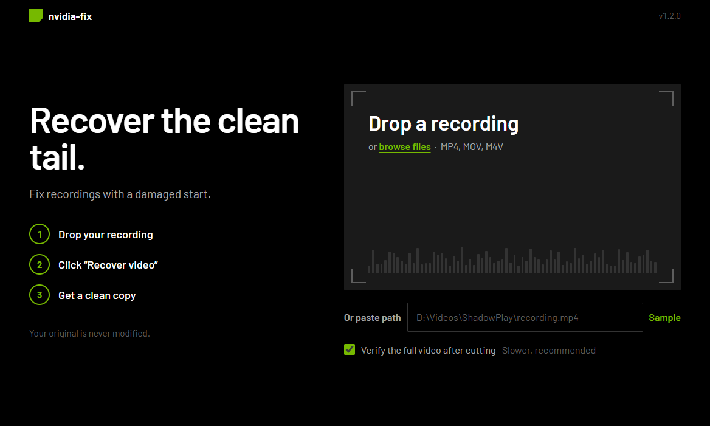
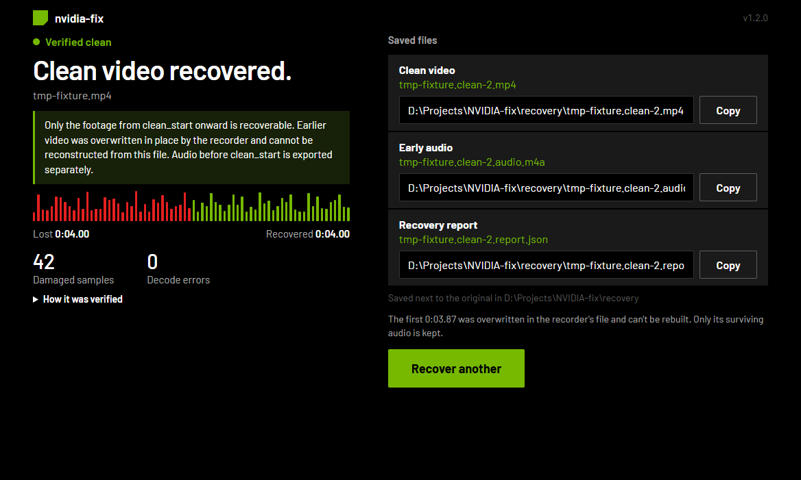

# NVIDIA-Fix

**Recover the clean tail of a corrupted NVIDIA ShadowPlay recording — locally, without re-encoding the surviving video.**

[](https://github.com/yassine808/NVIDIA-fix/actions/workflows/ci.yml)
[](https://github.com/yassine808/NVIDIA-fix/releases/latest)
[](https://github.com/yassine808/NVIDIA-fix/releases)
[](LICENSE)
[](#desktop-app-windows)

<p align="center">
  <a href="https://github.com/yassine808/NVIDIA-fix/releases/latest/download/NVIDIA-Fix.exe">
    
  </a>
</p>

<p align="center">
  
</p>

<p align="center">
  <b>Drop a ShadowPlay clip → click Recover video → get a clean copy beside the original.</b><br>
  No uploading, no re-encoding, no cloud. Your recording never leaves the machine.
</p>

NVIDIA-Fix is a native Windows desktop app and command-line tool for a specific
ShadowPlay failure: the recorder replaces the beginning of a clip with a
byte-shifted copy of later footage while leaving the MP4 index intact. Players
show a broken or duplicated opening, but the ending is usually untouched.

NVIDIA-Fix finds the exact point where the damage stops, stream-copies the
clean tail from the first verified keyframe, exports the surviving early audio,
and writes a JSON report with the evidence.

It is deliberately honest: **it recovers what still exists, and it tells you
what was destroyed.**

## Why the first part cannot be rebuilt

This is not a missing index, a bad moov atom, or a file-header problem. In the
real recording used to validate this tool, the first **113.78 seconds** of video
were overwritten in place with a drifting copy of later video, followed by
high-entropy garbage. The original bytes no longer exist in the file.

Forensic packet mapping from that recording:

| Original timestamp | Bytes now come from |
| --- | --- |
| `0.00 s` | `182.315 s` |
| `10.01 s` | `193.531 s` |
| `30.01 s` | `213.506 s` |
| `50.01 s` | `234.764 s` |
| `70.01 s` | `259.622 s` |
| `90.01 s` | `281.880 s` |
| `100.01 s` | `291.913 s` |
| `110.01 s` | no match — garbage |

The container still describes a 300-second recording, but the early video
samples point at copies of later samples. Rebuilding the missing gameplay from
those copies would produce the wrong footage, not a recovery. No tool can
invent the original frames.

**Full 300-second video is possible only if another copy of the same gameplay
exists** — a stream/VOD, a second capture, a backup, or an editor cache. If you
find one, use the recovered clean tail from this app and the donor's first
114 seconds, aligned at the cut. The app will not pretend that a donor is the
original.

## What you get

<p align="center">
  
</p>

For an input named `clip.mp4`:

| Output | Contents |
| --- | --- |
| `clip.clean.mp4` | Video stream-copied from the first clean IDR, plus the original audio |
| `clip.clean.audio.m4a` | Audio from before the cut, so the early sound is not lost |
| `clip.clean.full-length.mp4` | Optional complete-length rebuild: the copied opening, then the clean tail, with the original audio for the whole timeline |
| `clip.clean.report.json` | Boundary timestamps, sample counts, packet SHA-256, decode results |

Existing files are never overwritten. A second run produces `clip.clean-2.mp4`,
and so on. The input is opened read-only.

The full-length rebuild is only written when a duplication map sits next to the
input (see `explain` below), because that map is what proves which later footage
the recorder wrote over the head. Its opening **repeats** footage from later in
the same recording — same session, real frames, wrong position on the timeline.
It is a rebuild, never the lost original opening, and both the report and the app
label it that way.

## Desktop app (Windows)

### ffmpeg ships with the app

ffmpeg and ffprobe are bundled: `npm run fetch-ffmpeg` downloads the latest
Windows build from gyan.dev into `recovery/tools/ff/`, `npm run dist` copies it
into the installer, and the engine always prefers that copy over anything on
`PATH` (override with `FFMPEG_BINARY` / `FFPROBE_BINARY` if you want your own).

Building a package therefore needs network access once; running the app never
does. If you prefer a system install anyway:

```powershell
winget install Gyan.FFmpeg
```

### Download and run

Download **[NVIDIA-Fix.exe](https://github.com/yassine808/NVIDIA-fix/releases/latest/download/NVIDIA-Fix.exe)**
from the latest release and double-click it.

1. Drop the corrupted recording, browse for it, or paste its full path.
2. Leave **Verify the full video after cutting** ticked for the full decode.
3. Click **Recover video**.

Outputs are written next to the original, and the result page lists every file
with its absolute path. The app shows the damage boundary, the recovered
duration, packet count, decode errors, and a lost/recovered timeline. Recovery
runs in a background process, the window stays responsive, and the run can be
cancelled. When the rebuild exists, the result page also labels it as a rebuild.

### Run from source

The whole app is Electron + TypeScript in this repository root. The recovery
engine is TypeScript too (`src/engine/`): the main process spawns
`dist/engine/bridge.js` with Electron in Node mode, and it streams progress back
to the window as JSON lines.

```powershell
npm install
npm start
```

`npm run build` type-checks and compiles `src/` into `dist/`. The renderer is
sandboxed and has no Node access. `npm run smoke -- --path <video>` drives the
real window end to end with only Node built-ins.

Supported actions: **Browse files**, drag-and-drop, or paste a path; live
progress; cancel; and a copyable path for every output.

Output names are `‹name›.clean.mp4`, `‹name›.clean.audio.m4a` and
`‹name›.clean.report.json`, all next to the input.

## CLI (from a source checkout)

The engine also has a command-line front end, but it is **not** part of the
installed app — there is no `nvidia-fix.exe` command on `PATH`. Run it from a
clone:

```powershell
# inspect without writing anything
npm run engine -- analyze "D:\Videos\clip.mp4"

# recover
npm run engine -- fix "D:\Videos\clip.mp4"

# choose an output directory / skip the full decode (faster)
npm run engine -- fix "D:\Videos\clip.mp4" --out "D:\Recovered" --no-full-decode

# also rebuild the complete length (copied opening + clean tail + original audio)
npm run engine -- fix "D:\Videos\clip.mp4" --full-length

# machine-readable output
npm run engine -- analyze "D:\Videos\clip.mp4" --json
npm run engine -- fix "D:\Videos\clip.mp4" --json

# how much of the damaged opening is a copy of later footage, and how much is gone
npm run engine -- explain "D:\Videos\clip.mp4"
```

Exit codes: `0` success (including an already-healthy file), `2` a handled error
such as an unsupported codec or no clean keyframe.

## How it works

1. `ffprobe` lists every video packet with its timestamp, size, and byte offset.
2. Each sample is checked as an AVCC H.264 sample. Every length-prefixed NAL
   unit must fit, the forbidden bit must be clear, and the NAL type must be
   1–12. Multi-NAL samples are parsed fully. No decoding is needed for this pass.
3. The **last invalid sample** is the damage boundary.
4. The first keyframe after the boundary with a stable run of valid samples is
   the clean start.
5. `ffmpeg -ss <start + 0.005> -i input -c copy` cuts from that IDR. The offset
   makes the seek land on the chosen keyframe.
6. The first output video packet is compared byte-for-byte with the source
   sample. If it does not match, the next candidate keyframe is tried.
7. The first two seconds are decoded; then the full recovered video is decoded
   and any error lines are recorded in the report.
8. Early audio is exported with `-t <boundary> -c copy`.

Audio packet granularity means the early-audio file can include a fraction of a
second that belongs after the video boundary. Video frames are never duplicated
or re-encoded.

## Verified on a real corrupted recording

The detector and cut were validated against a 439,194,252-byte ShadowPlay DVR:

- **35,998** video samples, **11,000** invalid
- Last invalid sample at **113.781922 s**
- First clean IDR at **114.031811 s** (index 13,680)
- **22,318** video packets recovered, **185.98 s** of video
- First and last output packet SHA-256 matched the source
- Full decode: **0 errors**
- Original, `fixed.mp4`, and recovered files were hash-checked; the input was
  never modified

The full-length rebuild of the same recording (`--full-length`, or the checkbox
in the desktop app) measures:

- Video **300.008622 s / 35,999 frames**, audio **300.010250 s / 14,062 frames**
  (the original frame count)
- Fills **114.032 s** of the missing opening with footage from
  **182.540–296.572 s** of the same recording — the window the recorder copied
  over the head — then the untouched tail from 114.031811 s
- Full decode at below-normal priority: **0 H.264 errors, 0 AAC errors**
- Its output is labelled a rebuild everywhere: filename, report
  `full_length.caveat`, CLI line, and the app's result card

The early video in that file was overwritten by a drifting copy of later
footage, then replaced by high-entropy garbage with no recoverable reference
frames. That section is not recoverable from this file, and the app says so.

### How much is duplicated, how much is gone

`npm run engine -- explain` answers that from the recorded duplication map
(`forensics/duplication_dense.py`), clipped at the measured damaged boundary:

```
Damaged prefix : 113.782 s
  copied later : 105.730 s (92.9% of the prefix, 80.8% of the scanned blocks)
  destroyed    : 8.052 s
  copy window  : container 0.12 s -> content 182.54 s ... 107.54 s -> 299.79 s
Recoverable    : 186.231 s of 300.013 s (62.1%)
```

So the missing 113.782 s is not 113.782 s of vanished pictures: 105.730 s of it
is a byte-shifted copy of footage that still exists later in the file (which is
why the opening plays smeared and duplicated), and **8.052 s exists nowhere in
these bytes**. No repair tool restores the original 300 s from this file. The
same numbers appear in the recovery report as `duplication`, and in the desktop
app under the result card.

## Supported input

- H.264 (AVC) in MP4, MOV, or M4V
- Files whose packets expose byte offsets (normal non-fragmented MP4/MOV)
- Corruption that leaves a valid keyframe somewhere after the damage

HEVC is rejected with a clear error. Support would require parsing HEVC NAL
headers and choosing a clean IRAP frame; the current version deliberately does
not guess. Fragmented MP4 may not expose packet offsets; remux with `-c copy`
first.

## Build the Windows executable

```powershell
npm install
npm run dist
```

`npm run dist` downloads the latest ffmpeg build if needed, compiles the
TypeScript app, stages the engine plus that portable ffmpeg, and runs
electron-builder, producing `release\NVIDIA-Fix-1.2.0-portable.exe`. The
installer carries its own `ffmpeg.exe`/`ffprobe.exe`, so the target machine
needs nothing installed.

## Tests

```powershell
npm test
```

The Node test suite pins the duplication arithmetic, the full-length plan and
the AVCC/decoder classification. The end-to-end check builds a synthetic
corrupted clip with ffmpeg, runs the real CLI, and verifies the outputs:

```powershell
python scripts/ci_e2e.py
```

`python scripts/make_fixture.py <out.mp4>` writes a corrupted clip for manual
runs. Both helpers need Python 3.9+; the app itself does not.

## CI

Every push to `main` and every pull request runs four independent Windows checks
from [`.github/workflows/ci.yml`](.github/workflows/ci.yml):

| Check | What it proves |
| --- | --- |
| **1 / Quality and docs** | Python dev tools byte-compile; CLI version works; release files exist |
| **2 / Unit and integration tests** | Duplication verdict, full-length plan, and the synthetic end-to-end recovery |
| **3 / Desktop app** | `npm ci`, type-check, and the Electron build compile cleanly |
| **4 / CLI recovery** | A synthetic corrupted MP4 is analyzed, recovered, and hash-checked end to end |

## FAQ

**Does this overwrite my original?**
No. The input is opened read-only. Outputs get unique names and existing files
are never overwritten.

**Can it recover 100% of my clip?**
Only if another copy of the missing section exists outside this file. If the
original video bytes were overwritten in place, no software can reconstruct
them from this file. NVIDIA-Fix recovers the clean tail and the early audio, and
its report explains the boundary.

**Why is the recovered video shorter than the original?**
Because the beginning was destroyed. The output starts at the first verified
clean keyframe. The early audio is saved separately.

**Does it re-encode the clean tail?**
No. The surviving video is stream-copied; quality is identical to the source.

**Does it support HEVC?**
Not yet. H.264 MP4/MOV/M4V is supported.

**Which recordings does it target?**
ShadowPlay/GeForce Experience DVR clips with this in-place overwrite pattern. It
may help with similar H.264 corruption, but it will refuse to invent a result if
no clean keyframe exists.

## Project layout

| Path | Purpose |
| --- | --- |
| `src/engine/` | Recovery engine, JSON report, CLI |
| `src/` | Electron main process, preload bridge, renderer, shared types |
| `scripts/` | Build helpers, fixture generator, end-to-end CLI check |
| `build/` | App icon (window, taskbar, favicon) |
| `tests/` | Unit, integration, and real-file tests |
| `forensics/` | Standalone MP4 analysis tools used for the evidence chain |
| `.github/workflows/ci.yml` | Four Windows CI checks |

## License

[MIT](LICENSE) © 2026 yassine808

If this tool saved a clip you cared about, a star helps other ShadowPlay users
find it.
